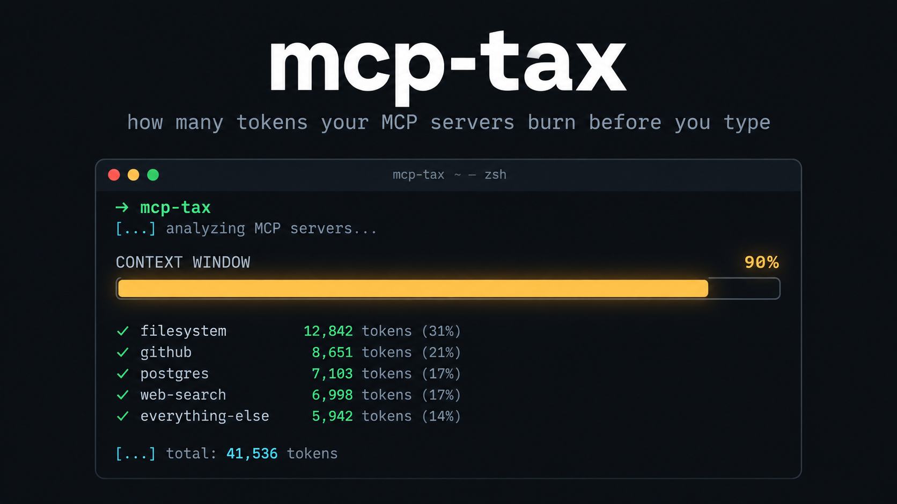

# mcp-tax

[](https://www.npmjs.com/package/mcp-tax-cli)
[](https://github.com/princejain756/mcp-tax/actions/workflows/ci.yml)
[](LICENSE)

**How many tokens do your MCP servers burn before you type a word?**



Every tool, prompt and resource an MCP server exposes gets serialized into your
model's context window. Add a few servers and the meter is already running.

```bash
npx mcp-tax-cli
```

```
SERVER            TOOLS  ~TOKENS
----------------  -----  -------
claude-code       20     14.3k
chrome-devtools   30     5.3k
blender           9      3.5k
filesystem        14     1.6k
everything        13     1.1k
memory            9      897
sequential-thinking 1    839
brave-search      2      301
fetch             1      235
time              2      222

Total: ~29.0k tokens before you type a word.
  14.5% of a 200.0k context window
  22.6% of a 128.0k context window
  90.5% of a 32.0k context window
```

90% of a 32k window gone to tool schemas. If you run local models, that number
should scare you.

## What it does

- Finds MCP configs automatically: Claude Desktop, Claude Code (`~/.claude.json`),
  Cursor (`.cursor/mcp.json`), project `.mcp.json`, `.vscode/mcp.json`
- Starts each server over stdio, calls `tools/list`, `prompts/list`,
  `resources/list`
- Counts the tokens in the same payload your client sends the model
  (names, descriptions, `inputSchema`s)
- Prints a per-server table, the biggest single tool schema, and your total as a
  percentage of 200k / 128k / 32k context windows
- `--json` for scripting

## Install

```bash
npx mcp-tax-cli   # run it once, no install
npm i -g mcp-tax-cli            # or keep it around
```

Requires Node 18+. Servers are spawned exactly as your client would spawn them
(`npx`, `uvx`, or any command in the config).

## Agent skill

Also on [Agensi](https://www.agensi.io/skills/mcp-tax) as an installable agent
skill: same audit, packaged with a runner script and a reclaim playbook so
your agent can measure and act on it in one step.

## Leaderboard

Real measurements of popular servers, no API key required:
[LEADERBOARD.md](LEADERBOARD.md)

## Notes

- Token counts use OpenAI's o200k tokenizer — an **approximation**. Claude and
  local models tokenize differently; treat the numbers as directional.
- No server code is modified; it just connects as a normal MCP client and
  disconnects. Servers that never finish their handshake are skipped after 15s.
- Nothing is sent anywhere. It's your machine, your servers, local counting.

## Why

MCP made tools composable, but nothing shows you the cost. Client UIs display
context use *after* the fact, inside one client, and only if you go looking.
This runs across all your configs and puts the bill on one screen.

PRs welcome — config locations for other clients (Windsurf, Zed, Cline, Gemini
CLI), better tokenizers, a `--badge` flag.
